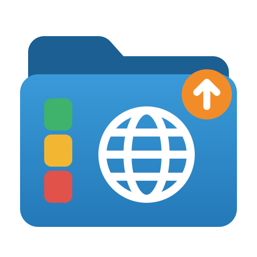

<p align="center">
  
</p>

<h1 align="center">files</h1>

<p align="center">
  A fast, keyboard-friendly file manager for any Linux desktop, written in Rust on
  <a href="https://gpui.rs">GPUI</a>.
</p>

<p align="center">
  <a href="https://github.com/bboysidou/files/releases/latest"></a>
  <a href="LICENSE"></a>
</p>

Inspired by [Flea](https://github.com/thisisgm/flea). `files` is a from-scratch rewrite that
runs on any Linux desktop instead of a single distribution. It shares no code with Flea, and the
Flea project is not involved in it.

- [Highlights](#highlights)
- [Requirements](#requirements)
- [Build and install](#build-and-install)
- [Desktop integration](#desktop-integration)
- [Features](#features)
- [Command line](#command-line)
- [Keys](#keys)
- [Files on disk](#files-on-disk)
- [Security](#security)
- [Troubleshooting](#troubleshooting)
- [Development](#development)
- [Licence](#licence)

## Highlights

- GPU-rendered interface that stays smooth on folders with many thousands of entries
- Vim-style keys by default, or a Classic preset where typing a name jumps to it
- List, columns, grid and dual-pane views, tabs and several windows
- Quick Look for images, video with sound, PDF, Markdown, source code, archives, fonts and
  office documents
- Network locations (SSH, SFTP, SMB, FTP, WebDAV, NFS), hosts from `~/.ssh/config`, phones and
  USB drives in the sidebar
- Asks for your password through polkit when an action is denied, instead of failing
- Helpers that read untrusted files run in a bubblewrap sandbox
- Can replace your default file manager and the GTK/KDE file chooser dialog
- English and French

Early development: expect rough edges, and back up what matters before trusting it with bulk
operations.

## Requirements

- Linux, on a Wayland compositor or an X11 session (GNOME, KDE Plasma, Hyprland, Sway, Xfce and
  so on)
- A GPU driver with Vulkan (preferred) or OpenGL ES: Mesa for AMD and Intel, the proprietary
  driver for NVIDIA
- A recent stable Rust toolchain to build. The project uses edition 2024; install it with
  [rustup](https://rustup.rs), because the Rust packaged by Debian and Ubuntu is often too old
  for the dependencies

### Build dependencies

**Arch Linux, Manjaro, EndeavourOS**

```sh
sudo pacman -S --needed base-devel rust libxkbcommon libxkbcommon-x11 libxcb wayland \
  fontconfig freetype2 vulkan-icd-loader
```

The `rust` package conflicts with `rustup`. If you already use `rustup`, skip `rust` and run
`rustup default stable` instead.

**Fedora**

```sh
sudo dnf install gcc gcc-c++ make pkgconf-pkg-config rustup libxkbcommon-devel \
  libxkbcommon-x11-devel libxcb-devel wayland-devel fontconfig-devel freetype-devel \
  vulkan-loader
rustup-init -y
```

**Debian, Ubuntu, Linux Mint, Pop!_OS**

```sh
sudo apt install build-essential pkg-config curl libxkbcommon-dev libxkbcommon-x11-dev \
  libxcb1-dev libxcb-xkb-dev libwayland-dev libfontconfig-dev libfreetype-dev \
  libvulkan1 mesa-vulkan-drivers
curl --proto '=https' --tlsv1.2 -sSf https://sh.rustup.rs | sh
```

Open a new shell after installing rustup so `cargo` is on your `PATH`.

### Runtime tools

`files` itself is one binary. Everything below is an external program it calls when you use the
matching feature. A missing tool turns off that one feature; the rest keeps working.

| Feature | Programs | Arch | Fedora | Debian / Ubuntu |
| --- | --- | --- | --- | --- |
| Open files, default file manager | `xdg-open`, `xdg-mime` | `xdg-utils` | `xdg-utils` | `xdg-utils` |
| Network locations | `gio` + gvfs | `glib2` `gvfs` `gvfs-smb` `gvfs-nfs` | `glib2` `gvfs` `gvfs-fuse` `gvfs-smb` `gvfs-nfs` | `libglib2.0-bin` `gvfs` `gvfs-fuse` `gvfs-backends` |
| Phones and cameras | gvfs (MTP, gphoto2, AFC) | `gvfs-mtp` `gvfs-gphoto2` `gvfs-afc` | `gvfs-mtp` `gvfs-gphoto2` `gvfs-afc` | `gvfs-backends` |
| SSH hosts, fast `scp` copies | `ssh`, `sftp`, `scp` | `openssh` | `openssh-clients` | `openssh-client` |
| USB drives: mount, eject, format | `udisksctl`, `lsblk` | `udisks2` `util-linux` | `udisks2` `util-linux` | `udisks2` `util-linux` |
| Format as FAT32 / exFAT / NTFS / ext4 | `mkfs.*` | `dosfstools` `exfatprogs` `ntfs-3g` `e2fsprogs` | `dosfstools` `exfatprogs` `ntfsprogs` `e2fsprogs` | `dosfstools` `exfatprogs` `ntfs-3g` `e2fsprogs` |
| Password prompt for denied actions | `pkexec` + a polkit agent | `polkit` | `polkit` | `pkexec` |
| Sandbox for preview helpers | `bwrap` | `bubblewrap` | `bubblewrap` | `bubblewrap` |
| PDF preview | `pdftoppm`, `pdfinfo` | `poppler` | `poppler-utils` | `poppler-utils` |
| Archives, office documents | `bsdtar` | `libarchive` | `bsdtar` | `libarchive-tools` |
| Video and audio: info, thumbnails, playback | `ffprobe`, `ffmpeg`, `ffplay` | `ffmpeg` | `ffmpeg-free` (or `ffmpeg` from RPM Fusion) | `ffmpeg` |
| Font preview | `magick`, `fc-scan` | `imagemagick` `fontconfig` | `ImageMagick` `fontconfig` | `imagemagick` `fontconfig` |
| Photo details (camera, lens, exposure) | `exiv2` | `exiv2` | `exiv2` | `exiv2` |
| Terminal in this folder | any terminal | see [Features](#features) | | |

Everything at once:

**Arch**

```sh
sudo pacman -S --needed xdg-utils glib2 gvfs gvfs-smb gvfs-nfs gvfs-mtp gvfs-gphoto2 gvfs-afc \
  openssh udisks2 util-linux dosfstools exfatprogs ntfs-3g e2fsprogs polkit bubblewrap poppler \
  libarchive ffmpeg imagemagick fontconfig exiv2
```

**Fedora**

```sh
sudo dnf install xdg-utils glib2 gvfs gvfs-fuse gvfs-smb gvfs-nfs gvfs-mtp gvfs-gphoto2 gvfs-afc \
  openssh-clients udisks2 util-linux dosfstools exfatprogs ntfs-3g ntfsprogs e2fsprogs polkit \
  bubblewrap poppler-utils bsdtar ffmpeg-free ImageMagick fontconfig exiv2
```

**Debian / Ubuntu**

```sh
sudo apt install xdg-utils libglib2.0-bin gvfs gvfs-fuse gvfs-backends openssh-client udisks2 \
  util-linux dosfstools exfatprogs ntfs-3g e2fsprogs pkexec bubblewrap poppler-utils \
  libarchive-tools ffmpeg imagemagick fontconfig exiv2
```

Notes:

- **Fedora video codecs.** `ffmpeg-free` from the Fedora repositories cannot decode every
  format (H.264 and HEVC files may fail). For full support, enable
  [RPM Fusion](https://rpmfusion.org/Configuration) and run
  `sudo dnf swap ffmpeg-free ffmpeg --allowerasing`.
- **ImageMagick 7.** Font previews call `magick`, which only ImageMagick 7 provides. Debian 13,
  Fedora and Arch ship it; Ubuntu 24.04 and Debian 12 still ship ImageMagick 6, so font previews
  stay off there.
- **Polkit agent.** The password prompt comes from your desktop's polkit authentication agent.
  GNOME, KDE Plasma, Cinnamon and Xfce start one by themselves. On a standalone compositor
  (Hyprland, Sway, niri, river) start one yourself, for example `hyprpolkitagent`,
  `polkit-gnome` or `lxqt-policykit`.
- **Sound in video playback** goes through PulseAudio or PipeWire (`pipewire-pulse`).

## Build and install

```sh
git clone https://github.com/bboysidou/files.git
cd files
make                              # release build: target/release/files
sudo make install                 # install under /usr/local
```

`make install` puts these in place:

| Path (under `PREFIX`) | What |
| --- | --- |
| `bin/files` | the program |
| `share/applications/files_file_manager.desktop` | menu entry |
| `share/icons/hicolor/<size>/apps/files_file_manager.png` | icon, 16 to 512 px |
| `share/metainfo/io.github.bboysidou.files.metainfo.xml` | AppStream data for software centres |
| `share/doc/files/README.md`, `share/licenses/files/LICENSE` | docs and licence |

Other targets and variables:

```sh
make install PREFIX=$HOME/.local  # for your user only, no sudo
sudo make uninstall               # use the same PREFIX as the install
make install DESTDIR=pkg PREFIX=/usr   # staged install, for packagers
make dist                         # binary and source tarballs + SHA256SUMS in dist/
make icons                        # regenerate assets/logo/icons/ (needs rsvg-convert)
make clean                        # remove target/ and dist/
make help                         # list the targets
```

Run `make` as your user, then `sudo make install`: the install step never builds, so cargo never
runs as root. For a user install, make sure `~/.local/bin` is on your `PATH`.

The binary tarball from `make dist` (`files-<version>-<arch>-linux.tar.gz`) holds `bin/` and
`share/`, so it unpacks straight into a prefix:

```sh
tar -xzf files-0.1.0-x86_64-linux.tar.gz -C ~/.local --strip-components=1
```

To try it without installing:

```sh
cargo run --release -- ~/Downloads
```

## Desktop integration

### Default file manager

```sh
files --default        # open folders with files (inode/directory)
files --default off    # give the default back to the previous file manager
```

While `files` is the default, it also answers `org.freedesktop.FileManager1`, so "Show in folder"
in browsers and other apps opens it with the file selected.

`files --default` only changes the folder handler. Another file manager can still take over in
three places:

1. **D-Bus activation.** If another file manager starts on demand for `org.freedesktop.FileManager1`
   (Thunar, Nautilus and Dolphin all ship a service file for it), "Show in folder" starts that one
   while `files` is closed. Point the name at `files` with a user service file, which wins over the
   system ones, and stop the other manager's daemon:

   ```sh
   mkdir -p ~/.local/share/dbus-1/services
   printf '[D-BUS Service]\nName=org.freedesktop.FileManager1\nExec=/usr/local/bin/files\n' \
     > ~/.local/share/dbus-1/services/org.freedesktop.FileManager1.service
   systemctl --user stop thunar.service   # if Thunar runs as a daemon
   ```

   Adjust `/usr/local/bin` to your `PREFIX`. Check who answers with
   `busctl --user status org.freedesktop.FileManager1`.

2. **The desktop portal.** Browsers open folders through `xdg-desktop-portal`, which reads the
   applications directories once, when it starts. After the first install into a new prefix (the
   first `sudo make install` creates `/usr/local/share/applications`), the portal does not see
   `files` and falls back to the old file manager. Restart it, or log out and back in:

   ```sh
   systemctl --user restart xdg-desktop-portal.service xdg-desktop-portal-gtk.service
   ```

   Launchers and shells that list desktop entries can have the same blind spot; restart them too.

3. **Key bindings.** A compositor shortcut that runs `thunar` or `nautilus` by name still does.
   Change it to `files`.

### File chooser

`files` can stand in for the GTK or KDE dialog when apps ask the desktop portal for a file. Run
`files --picker`: it writes the D-Bus service files for your user and prints the two steps that need
you (copying `files.portal` into `/usr/share/xdg-desktop-portal/portals/` with sudo, and naming
`files` as the `FileChooser` in `~/.config/xdg-desktop-portal/portals.conf`). If a
`<desktop>-portals.conf` exists for your session (for example `hyprland-portals.conf` under
Hyprland), the portal reads that one instead, so add the line there:

```ini
[preferred]
org.freedesktop.impl.portal.FileChooser=files
```

Then restart `xdg-desktop-portal.service`. Open, save, multiple
selection and folder picking are supported. `Enter` picks, `Esc` cancels.

The backend also keeps `files` resident. `files --picker` registers the app's own D-Bus name too, so
the first launch starts `files --portal` and every later window opens inside that process instead of
starting a new one. Fonts, the GPU context and the shaders are already loaded, so a window maps in
about 30 ms instead of 250 ms to 1 s. The process stays after its last window closes; quitting it
with `pkill -f "files --portal"` is safe, D-Bus starts it again on the next launch.

### Window class

Every window uses the app id (Wayland) and class (X11) `files_file_manager`, and file chooser
dialogs use `files_file_manager_picker`, so the two can get different rules. Match on them in
compositor window rules (Hyprland `class`, Sway `app_id`, i3 `class`, KDE window rules), for
example in Sway:

```ini
for_window [app_id="files_file_manager"] floating enable
```

## Features

### Browsing

- Places sidebar built from your XDG folders, collapsible to an icon strip (`Ctrl+B`)
- Favorite folders in their own sidebar section: `Ctrl+Shift+D` or the context menu toggles the
  folder under the cursor; entries accept drops and `x` removes them
- List view of real folders: folders first, natural sort, sortable columns, sizes, item counts,
  kinds and relative dates
- List columns: Size, Kind, Modified and Created can each be shown or hidden in settings and
  resized by dragging the left edge of their header; a narrow pane drops Kind and Created
- Columns view (`Ctrl+2`): the parent folder on the left, the open folder in the middle, the
  folder under the cursor on the right; click a side column to move there
- Grid view with image and video thumbnails (`Ctrl+3`, back to the list with `Ctrl+1`), cached in
  the shared freedesktop thumbnail cache (`~/.cache/thumbnails`) that other file managers also use;
  videos show a play badge
- Dual pane (`Ctrl+4`): two folders side by side, `Tab` moves between them, `F6` copies the
  selection to the other side and `Shift+F6` moves it; drag the gap between them to resize
  (20–80 %, double-click resets, remembered across launches)
- Tabs, back/forward/up history, clickable path crumbs
- More windows (`Ctrl+N`). Drag a tab out of the window, or press `Ctrl+Alt+N`, to move it into
  a new window with its history. Settings changed in one window apply to all of them, and every
  open window comes back with its tabs at the next start
- Folders refresh by themselves when files change on disk
- Extension badges coloured from a hash of the extension, so every type gets a stable colour
- Overview page (sidebar): disk usage per device, your home folder by file type, and recent files
  from `recently-used.xbel` (click one to open its folder with the file selected)

### Search and tags

- Filter the current folder as you type, or search every name below it (`f`)
- Search inside files: start the search with `text:` (for example `text:TODO`); text files up to
  2 MB are scanned in the background, binary files skipped, and each hit shows its folder, the
  first matching line and how many more matches the file has, scanned on up to 8 threads; the
  preview column and Quick Look list every matching line with its line number. Typing again
  cancels the running scan
- Seven colour tags stored in the `user.xdg.tags` attribute (the one Dolphin reads); `tag:red` in
  search, or a click on a sidebar dot, lists every tagged file under Home

### File operations

- Copy, cut, paste, rename, new folder and move to Trash, all with undo and redo; copy and paste
  work with other file managers and apps through the system clipboard (Wayland)
- Copies show live progress in the sidebar and can be cancelled; later operations queue; pasting
  over existing names asks to keep both, merge folders, skip or replace (replaced items go to the
  Trash), also by key (`Enter`, `m`, `s`, `r`); a move across disks checks the copied size before
  deleting the source
- New file (`N`), duplicate (`Ctrl+D`) and paste as symbolic link (`Ctrl+Shift+V`)
- Rename several items at once (`r` with a selection): find and replace, or a new name with `{n}`
  numbering, live preview with clashes in red, one undo for the whole batch
- Compare two files (`=`): the two selected files, or the file under the cursor in each pane of
  the dual view. Text files up to 2 MiB get a side-by-side diff, images show side by side, other
  files report whether their bytes are identical
- Drag and drop: drag rows or tiles onto a folder, the open folder or a sidebar place; same disk
  moves, another disk copies, `Ctrl` while dropping always copies. Files dragged out of the window
  go to other apps, and files dropped in from other apps are copied or moved the same way
- Rubber-band selection in the list and grid: drag from empty space; `Ctrl` or `Shift` adds to the
  current selection
- Trash view: Enter restores, Delete deletes permanently after a confirmation, Empty Trash in the
  menu or by right-clicking Trash in the sidebar, with confirmation before emptying
- Properties (`i`): kind, location, size, dates, owner and permissions (`1`–`9` toggle, undoable)
- When the system refuses an action (a root-owned folder, a drive that needs authorisation), an
  **Authenticate** button asks for your password through polkit and retries. A red **Admin** chip
  in the status bar shows the elevated session; click it to end it. It also ends after 10 idle
  minutes

### Quick Look and previews

- Quick Look (`Space`) for images, folders, source code with syntax colour, rendered Markdown and
  the first pages of a PDF (`j` `k` turn pages); `h` `l` move to the previous or next file
- Videos open on their first frame. `Enter` plays and pauses with sound, the progress bar shows
  the current and total time, and a click on the bar seeks
- Video and audio show duration and codecs; fonts show a rendered specimen; photos list camera,
  lens, date taken, exposure, aperture, ISO and focal length; docx, odt, pptx and odp files
  preview their text
- Preview column beside the list that follows the cursor (`F3`)

### Archives

- Zip, tar.gz/xz/zst/bz2, 7z, rar, iso, cpio and jar: Quick Look and the preview column list what
  is inside
- `e` extracts next to the archive into a folder named after it (one top-level folder is not
  nested twice); `c` compresses the selection to `.zip` (`.tar.gz` from the menu), undoable
- `B` opens an unpacked copy in a new tab (kept in `~/.cache/files/archives`; changes do not go
  back into the archive)

### Network, SSH and phones

- Type a path to jump there (`:` or `Ctrl+L`, `~` for home); network locations work too
  (`ssh://`, `sftp://`, `smb://`, `ftp://`, `dav://` or `user@host:/path`), mounted with `gio mount`. A
  server that asks for a login opens a user/password dialog (plus domain for `smb://`); the
  password is passed to gio once and never saved
- Connect dialog (`Ctrl+K` or the sidebar button) with two tabs: **Servers** lists your SSH hosts
  and saved servers with filtering, pinning, editing and deletion; **New connection** picks a
  server type (SSH, SFTP, FTP, FTPS, SMB, DAV, DAVS, NFS) and address
- Mounted shares are listed under Network in the sidebar with a disconnect button. Saved servers
  carry a protocol badge, a key for encrypted protocols or a red warning triangle for FTP, DAV and
  NFS; `e` or the pencil edits one, `x` or `×` forgets it
- SSH hosts come from `~/.ssh/config` (following `Include`) and carry an SSH badge; they connect
  with `ssh://alias/`, so your config's user, port and key apply. Pinned or mounted hosts appear
  in the sidebar. Copies between a local folder and an SSH or SFTP mount use `scp` with live progress when
  the host accepts your key
- Phones and cameras (MTP, gphoto2, AFC) appear in a Phones section; open one to mount it, eject
  to unmount

### Drives

- USB drives in the sidebar: click to mount and open, eject button to unmount and power off
- Right-click a USB volume to format it as FAT32, exFAT, NTFS or ext4 (only installed formatting
  tools are offered). The dialog identifies the selected volume and asks for confirmation before
  erasing it; other partitions are kept. An optional volume name is checked against the
  filesystem's naming rules. Only writable, non-system USB volumes with an existing filesystem are
  supported. Formatting is quick formatting, not secure erasure, and cannot be undone

### Apps and terminal

- Opening files with your default applications (`xdg-open`), or with any other app that lists the
  file type (`o`, default app first; terminal apps open in your terminal)
- A terminal in the current folder (`S`): `$TERMINAL` when set, otherwise the first of
  `xdg-terminal-exec`, kitty, foot, Alacritty, Ghostty, WezTerm, GNOME Terminal, Konsole, Xfce
  Terminal, Console or xterm found on your `PATH`

### Settings and languages

- Settings panel (sliders button, `,` or `Ctrl+,`): hidden files and whether they sort last, sort
  key (name, size, kind, modified, extension, created or random) and direction, view, preview
  column, key preset, and whether to reopen the last session or start in Home
- Optional per-folder view memory: a folder opens in the view last chosen there
- Remembers hidden files, sort order, the sidebar, the preview column, the view mode and your open
  tabs
- English and French, chosen from `LC_ALL` / `LC_MESSAGES` / `LANG` (a region such as `fr_FR`
  falls back to `fr`)

## Command line

```sh
files [PATH]           # open a folder, or the folder holding a file
files --select PATH    # open the folder and put the cursor on PATH
files --default        # make files the default file manager (inode/directory)
files --default off    # give the default back to the previous file manager
files --picker         # register files as the file chooser portal backend
files --portal         # run the resident backend: file chooser and windows (started by D-Bus)
```

Only one instance runs: launching `files` again opens the path as a new tab in the focused
window.

## Keys

Two presets, picked under Keys in the settings panel and applied at once. **Vim** (the default)
is the table below. **Classic** drops every plain-letter key so typing a name jumps to it
(the typed letters reset after a second), and moves the letter commands to `F1` (this sheet),
`Shift+F10` / Menu key (context menu), `Alt+Enter` (properties), `Ctrl+Space` (mark), `Ctrl+I`
(invert), `Alt+S` (folder sizes), `Ctrl+Shift+F` (filter), `Alt+1`–`9` (tabs),
`Alt+PgDn` / `Alt+PgUp` (PDF pages in the preview column) and `Ctrl+Alt+1`–`7` / `Ctrl+Alt+0`
(tags). Ctrl, F-key, arrow and Space keys are the same in both. The keymap sheet (`?`) shows the
keys of the active preset.

| Keys | Action |
| --- | --- |
| `j` `k` / `↓` `↑` | Move the cursor |
| `gg` / `G` | First / last row |
| `Enter` `l` `→` | Open |
| `o` | Open with another app |
| `i` | Properties: kind, location, size, dates, owner, permissions (`1`–`9` toggle, undoable) |
| `S` | Terminal in this folder |
| `e` | Extract an archive here |
| `c` | Compress the selection to `.zip` |
| `B` | Browse an archive in a new tab |
| `=` | Compare two files |
| `h` `←` `Backspace` | Parent folder |
| `Alt+←` / `Alt+→` | Back / forward |
| `t` / `w` | New / close tab |
| `1`–`9`, `[` `]` | Go to a tab |
| `{` `}` / `Ctrl+Shift+PgUp` `PgDn` | Move the tab left / right (or drag it) |
| Mouse back / forward buttons | Back / forward |
| `/` / `Esc` | Filter this folder / clear the filter |
| `f` / `Ctrl+F` | Search names below this folder |
| `T` then `1`–`7` / `T` `0` | Toggle a colour tag / clear colour tags |
| `:` / `Ctrl+L` | Type a path |
| `v` / `Ctrl+A` / `Shift+↓↑` | Select / select all / extend |
| `Shift+→` / `Shift+←` | Expand a folder in place / collapse it (list view) |
| `V` | Invert the selection |
| `s` | Measure folder sizes (marked folders, or every folder here; stays on one disk) |
| `y` `x` `p` | Copy / cut / paste |
| `r` `F2` | Rename |
| `N` / `Ctrl+D` / `Ctrl+Shift+V` | New file / duplicate / paste as symbolic link |
| `dd` `Delete` | Move to Trash |
| `Ctrl+Shift+N` | New folder |
| `Ctrl+Shift+D` | Add or remove a favorite folder |
| `z` / `Ctrl+Shift+Z` | Undo / redo |
| `Space` | Quick Look: `h` `l` / `←` `→` previous / next file, `j` `k` / `↓` `↑` scroll or turn PDF pages, `+` `−` zoom, `Enter` play or pause a video |
| `Ctrl+N` / `Ctrl+Alt+N` | New window on the current folder / move the current tab to a new window |
| `Ctrl+K` | Connect to a server |
| `F3` | Show or hide the preview column |
| `Shift+J` `Shift+K` | Next / previous page of a PDF in the preview column |
| `Ctrl+1` `Ctrl+2` `Ctrl+3` `Ctrl+4` | List, columns, grid, dual pane |
| `Tab` / `F6` / `Shift+F6` | Dual pane: other side / copy there / move there |
| `m` / right click | Context menu |
| `Ctrl+0` | Move between the sidebar and the file list; in the sidebar `j` `k` move, `Enter` opens a place, drive or server, or searches a tag, `x` ejects a drive, disconnects or forgets a server, `e` edits a saved server, `Esc` goes back |
| `,` / `Ctrl+,` | Settings |
| `Ctrl+Shift+C` | Copy path |
| `?` | Keyboard shortcuts |
| `Ctrl+H` | Show hidden files |
| `F5` / `Ctrl+R` | Reload and report how many rows were added, removed or changed (rarely needed, folders update live) |
| `Ctrl+B` | Collapse the sidebar |

## Files on disk

| Path | Content |
| --- | --- |
| `~/.config/files/settings.toml` | settings, open tabs, saved servers and pins (never passwords) |
| `~/.cache/files/` | PDF pages, video posters and unpacked archives for previews |
| `~/.cache/thumbnails/` | freedesktop thumbnail cache, shared with other file managers |

`$XDG_CONFIG_HOME` and `$XDG_CACHE_HOME` are honoured. Settings are saved as you go. A settings
file that cannot be read is moved to `settings.toml.bak` and the defaults are used. Deleting
`~/.cache/files/` is always safe.

## Security

- **Sandboxed helpers.** Programs that parse untrusted files (`pdftoppm`, `pdfinfo`, `bsdtar`,
  `ffprobe`, `ffmpeg`, `ffplay`, `magick`, `exiv2`) run inside bubblewrap when `bwrap` is installed: no
  network, empty environment, read-only `/usr`, read access to the one input file and write
  access only to their output folder. Video playback also gets the audio socket. Without `bwrap`
  they run directly, so install it.
- **Archives.** Extraction uses `bsdtar`, which refuses `..` and absolute paths.
- **Elevation.** Denied actions retry through `pkexec files --admin-helper`, a separate process
  that accepts a fixed set of operations, only absolute normalised paths, caps request size,
  refuses to run unless it is root and exits after 10 idle minutes. Nothing is sent to the
  Trash while elevated, so root-owned files never land in root's Trash.
- **Passwords.** Network passwords go to `gio` once and are never written to disk.

## Troubleshooting

| Symptom | Fix |
| --- | --- |
| No icon in the menu or the title bar after install | Log out and back in, or run `gtk-update-icon-cache -f /usr/local/share/icons/hicolor` (adjust to your `PREFIX`). |
| `files: command not found` after a user install | Add `~/.local/bin` to your `PATH`. |
| Browsers' "Show in folder" still opens the old file manager | Restart the desktop portal and check the D-Bus service; see [Default file manager](#default-file-manager). |
| Blank or black window, or the app exits at start | Install the Vulkan driver for your GPU (`vulkan-radeon` / `vulkan-intel` / `nvidia-utils` on Arch, `mesa-vulkan-drivers` on Fedora and Debian). |
| **Authenticate** does nothing | No polkit agent runs in your session; start one (see [Runtime tools](#runtime-tools)). |
| `ssh://`, `sftp://` or `smb://` fails at once | Install the gvfs backend for that protocol and make sure `gio` is on your `PATH`. |
| SSH copies have no progress bar | The host does not accept your SSH key without a password; `files` then falls back to a plain copy. Add your key with `ssh-copy-id`. |
| Video plays without sound | Check that PipeWire (`pipewire-pulse`) or PulseAudio runs. |
| Video does not play on Fedora | Swap `ffmpeg-free` for RPM Fusion's `ffmpeg`. |
| No PDF, archive, font or photo details | Install the matching tool from [Runtime tools](#runtime-tools). |

## Development

```sh
cargo run                              # debug build
cargo clippy --all-targets             # must report no warnings
cargo fmt --check
python3 scripts/check_locales.py       # en/fr locale keys must match
```

The code follows a clean architecture per feature: `src/features/<feature>/` holds `domain/`
(entities, repository traits, use cases), `data/` (implementations that talk to the system) and
`presentation/` (GPUI views and actions). Shared code lives in `src/core/` (constants, enums,
helpers, theme, dependency injection) and reusable UI in `src/global_components/`. User-facing
text lives in `locales/en.yml` and `locales/fr.yml`.

The app icon master is `assets/logo/files_logo.svg`; after changing it, run `make icons`.

## Licence

GPL-3.0-or-later. See [LICENSE](LICENSE).

The bundled [JetBrains Mono](https://github.com/JetBrains/JetBrainsMono) font is licensed under the
SIL Open Font License 1.1, see [assets/fonts/OFL.txt](assets/fonts/OFL.txt).
